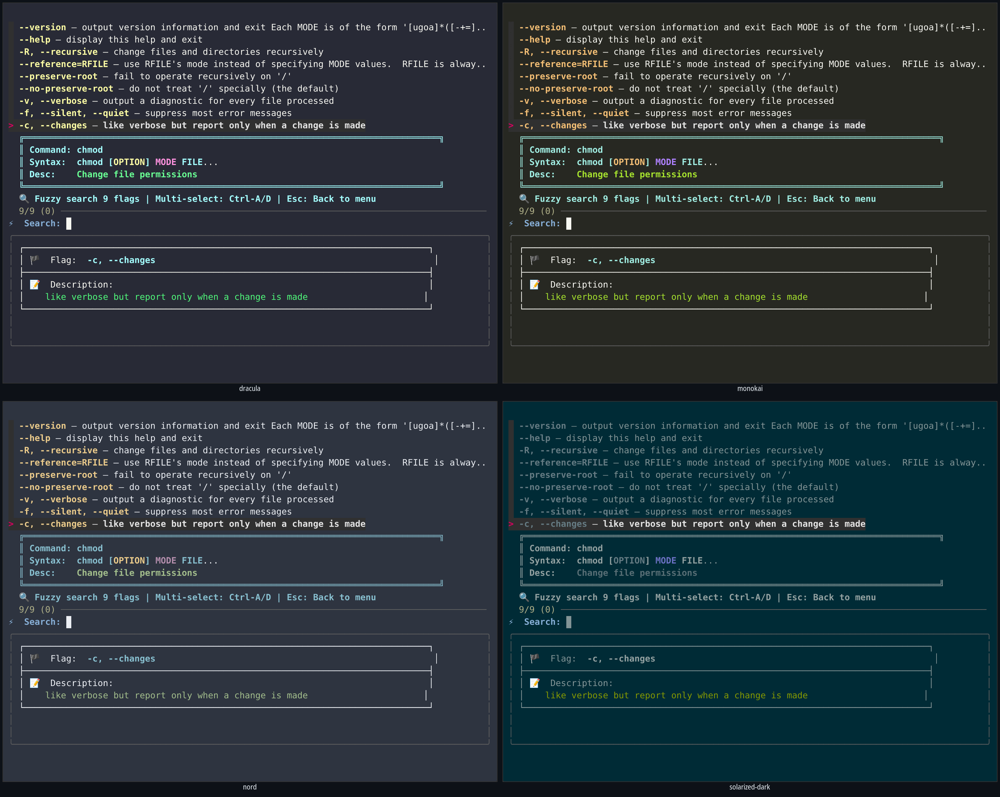

# super-man

An interactive, fuzzy command + man-page flag browser for the terminal. Search
260+ commands, drill into any one to fuzzy-search its flags with live
descriptions, and jump back to the command list instantly.

## Demo


Video (MP4): [`demo/super-man-demo.mp4`](demo/super-man-demo.mp4) ·
asciinema cast: [`demo/super-man-demo.cast`](demo/super-man-demo.cast)

The clip fuzzy-filters to `chmod`, opens its flag browser to scroll the
options with live man-page descriptions, then **Esc** back to the home
screen — and finishes with AI mode: turning plain English into a bash
one-liner and A/B-ing two local models side by side.

### Themes

super-man inherits your terminal's colors, so it looks at home in any palette:



#### Coherent theme randomizer

On a truecolor terminal you can also roll your own palette. Each theme is built
from a single random base hue plus a color-theory harmony scheme
(analogous / triadic / complementary / split-complement), with saturation and
lightness kept in a readable band — so the derived roles (primary, header,
accent, flags, values) always relate to each other and **never clash**.

```bash
super-man theme            # roll a new coherent theme
super-man theme show       # show the active theme and its seed
super-man theme 12345      # reproduce a theme by seed (deterministic)
super-man theme off        # reset to your terminal's default colors
```

Themes are deterministic per seed and persist across runs (cached under
`~/.cache/super-man/`). Inside the interactive home screen, press **Ctrl-T** to
shuffle to a fresh theme on the fly.

## Installation

super-man is a single, dependency-light bash script — it runs on **Linux, macOS,
and WSL** (any system with bash). 

**1. Install the dependencies for the features you want:**

| Tool | Needed for | Debian/Ubuntu | macOS | Fedora/RHEL | Arch |
|------|-----------|---------------|-------|-------------|------|
| `jq` | natural-language modes (`ask`/`task`/`category`/`explain`) | `sudo apt install jq` | `brew install jq` | `sudo dnf install jq` | `sudo pacman -S jq` |
| `fzf` | interactive home screen | `sudo apt install fzf` | `brew install fzf` | `sudo dnf install fzf` | `sudo pacman -S fzf` |
| `man` | richer flag descriptions (optional, usually preinstalled) | `man-db` | built-in | `man-db` | `man-db` |
| [`ollama`](https://ollama.com) | `ai` mode (local LLM) | `curl -fsSL https://ollama.com/install.sh \| sh` | `brew install ollama` | install script | install script |

Direct flag lookup (`super-man <command>`) works with **no dependencies at all**.

**2. Get super-man on your `PATH`:**

```bash
git clone https://github.com/leetcrypt/super-man.git
cd super-man
chmod +x super-man.sh

# symlink onto your PATH (pick a dir that's already on it)
mkdir -p ~/.local/bin
ln -sf "$PWD/super-man.sh" ~/.local/bin/super-man

# if ~/.local/bin isn't on PATH yet, add it (bash: ~/.bashrc, zsh: ~/.zshrc)
echo 'export PATH="$HOME/.local/bin:$PATH"' >> ~/.bashrc && source ~/.bashrc
```

macOS users on the system bash 3.2 are fine — super-man uses no bash-4-only
features. For the `ai` mode, after installing ollama run `ollama pull westenfelder/NL2SH`.

## Usage

```bash
super-man                       # interactive home screen (fzf)
super-man <command> [filter]    # jump straight to a command's flags
super-man -l, --list            # list all known commands
super-man -h, --help            # full help
super-man theme                 # roll a new coherent color theme (truecolor)
super-man theme <seed>          # reproduce a specific theme by seed
super-man theme show            # show the active theme + its seed
super-man theme off             # back to your terminal's default palette

# Natural-language modes (database-backed, needs jq)
super-man ask "find large files"        # ask a question
super-man task "monitor cpu usage"      # describe what you want to do
super-man category files                # browse by category (files/text/network/system)
super-man explain "tar -czf"            # explain what a command does
super-man ai "count lines in js files"  # AI bash one-liner via local LLM (advanced)
```

### AI mode (local LLM via ollama)


`ai` generates a bash one-liner from plain English using a local [ollama](https://ollama.com)
model. The default is `westenfelder/NL2SH`, a model purpose-built for
natural-language-to-shell — in our 25-query benchmark it was the most accurate, the
only one that handled hard multi-stage tasks. The model is configurable, so you can
still A/B other local LLMs:

```bash
super-man ai "find python files modified last week"          # default model (NL2SH)
super-man ai -q "list the 5 largest files"                   # quiet: print ONLY the command
super-man ai --model qwen2.5-coder:1.5b "count lines in js"  # override model
super-man ai --compare "list the 5 largest files"            # run several models side by side
```

The `-q` / `--quiet` / `--raw` flag prints only the generated command to stdout (errors
go to stderr), so it composes in scripts and pipelines:

```bash
cmd=$(super-man ai -q "compress the logs folder into a tarball")
echo "$cmd"            # tar -czf logs.tar.gz logs/
```

| Env var | Purpose | Default |
|---------|---------|---------|
| `SUPERMAN_AI_MODEL` | Default model for `ai` | `westenfelder/NL2SH` |
| `SUPERMAN_AI_COMPARE_MODELS` | Space-separated list for `--compare` | `westenfelder/NL2SH qwen2.5-coder:1.5b` |

The purpose-built `westenfelder/NL2SH` model receives the raw query; general coder
models (e.g. `qwen2.5-coder`) are prompt-wrapped to emit a single bare command. Pull
either with `ollama pull <model>`. See the
[benchmark write-up](tests/performance/) for the full model comparison.

`Esc` in the flag browser returns to the command list; `Esc` on the home screen
exits.

**Requirements:** `jq` for the natural-language modes, `fzf` for interactive mode.

See [`docs/`](docs/) for design notes and the full feature history.
